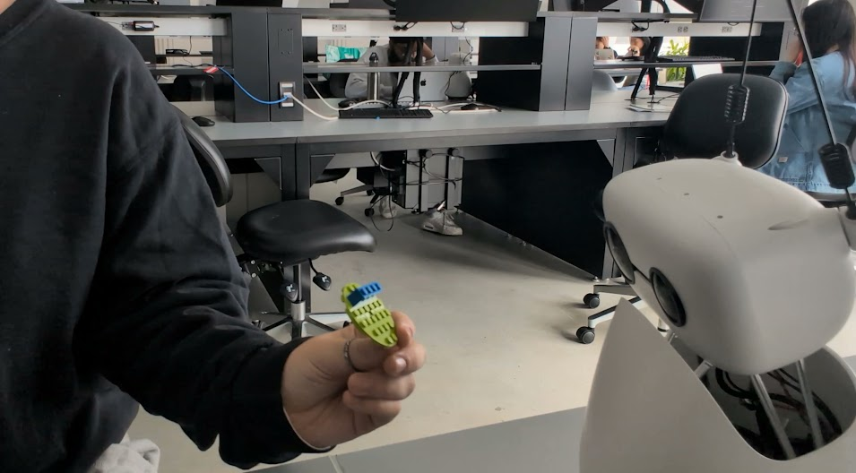
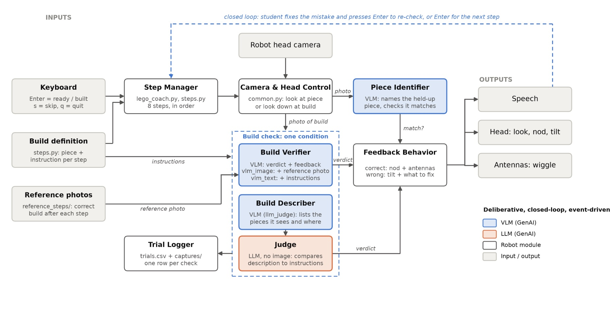
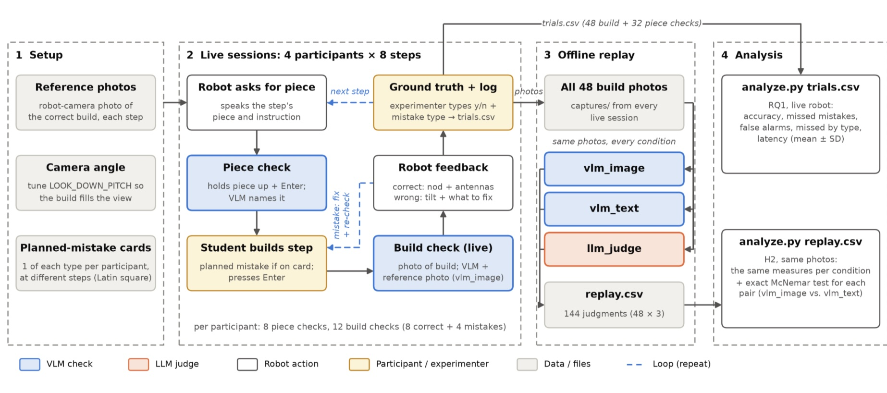

# Lab 3: GenAI for HRI

## 1. Introduction

### 1.1 Problem Statement and Scope
#### HRI Problem, Application, and LLM/VLM/VLA Scope

Hands-on building activities, such as assembling LEGO models, are a core part of middle school STEM education. They help students develop spatial reasoning, follow multi-step instructions, and learn engineering concepts through direct experience. These activities depend on timely feedback, though: a mistake in an early step, like a misplaced brick, often goes unnoticed until several steps later, when it is harder to fix. In a typical classroom, a single teacher supervises many groups at once and cannot check each student’s progress at every step. We will address this problem by developing a desktop robot coach that watches a student build and checks each step as it is completed. Our system uses a Reachy Mini robot with a camera and a Vision-Language Model (VLM). After the student finishes a step, the VLM compares an image of the current build against the reference instructions for that step. The robot then responds with speech and expressive head and antenna gestures, either confirming the step or pointing out the mistake. Our scope focuses on the end-to-end behavior of the robot, rather than on the VLM in isolation: whether it correctly verifies each step, whether it catches mistakes before the student moves on, and how quickly it responds.

#### Motivation and Importance to the HRI Community

Addressing this problem matters for both students and the HRI community. Middle school students are often reluctant to ask for help in front of their peers, so errors that a teacher does not notice may simply persist. A robot that monitors progress and offers feedback without being asked could reduce frustration and keep students engaged. For the HRI community, this application raises open questions about grounding visual perception in physical, real-world tasks. Prior work on robots in education has largely focused on conversational tutoring, while VLMs have mostly been evaluated on static image benchmarks rather than in real-time interactions with physical objects [CITE]. A robot coach for building tasks must judge small spatial details, like a brick’s color, position, and orientation, under real classroom conditions with changing lighting, camera angles, and partially hidden pieces. It must also communicate its judgments in a way a student will trust and act on, since false alarms and missed mistakes can both undermine the student’s confidence in the robot. Studying how VLM perception performs as part of an embodied, end-to-end robot system helps show whether today’s VLMs are ready to support hands-on learning, and where they still fall short.

#### Video Demo
[](https://drive.google.com/file/d/1H7UWmWmpJo0X0d25sjPVVclfngb3A_Xr/view?usp=sharing)

### 1.2 Research Questions / Hypotheses
#### RQ1 / H1

RQ1: How accurately does the robot coach verify each building step, and which kinds of student mistakes does it miss most often?

#### RQ2 / H2

H2: The robot will verify steps more accurately when the VLM gets a reference image of the correct step than when it gets only a text description of that step

### 1.3 HRI Literature Review and Research Gaps

#### Social Robots and Generative AI for Children’s Learning

Social robots have been widely studied as tutors and learning companions for children, and recent work has focused on how a robot’s behavior can support learning tasks. Ligthart et al. [1] designed a social robot math tutor and tested it in a three-session study with 130 children aged 8–11 (HRI 2023). Children improved at math over time when the robot scaffolded its instructions, and they saw the robot more as a friend when it personalized the conversation. More recently, researchers have begun adding LLMs to child-robot interaction. Rudenko et al. [2] studied the linguistic and interactive quality of language produced by an LLM-powered social robot for preschoolers and emphasized the need to validate LLM outputs before using them with children. Fernandes et al. [3] ran a co-design study with tutors and program coordinators for a classroom robot, noting that literacy programs are often limited by small staff, mixed-proficiency groups, and short contact time. This mirrors the supervision problem in hands-on STEM classrooms. Across this work, the robot mostly supports learning through conversation; the child’s learning activity happens in speech or on a screen rather than with physical objects.

#### Vision-Language Models for Task Verification and Error Detection

A second line of work uses foundation models to check whether a physical task was done correctly. REFLECT [4] (CoRL 2023) queries an LLM to reason about failures using a hierarchical summary of the robot’s past experiences built from multisensory observations, and the resulting explanation guides a planner to correct the failure. AHA [5] treats failure detection as a free-form reasoning task, so a VLM both identifies failures and explains them in natural language across different robots and tasks, and its feedback improved sub-task verification and raised task success by an average of 21.4%. Guardian [6] notes that VLM accuracy and generalization for this problem are limited by the scarcity of failure data. Closest to our task, Kottom et al. [7] built an AR headset system for LEGO assembly in which each step is validated by a VLM so that user mistakes are detected and the user gets feedback on how to return to a valid state. Together, these papers show that VLMs can verify individual steps of a physical task, though their reliability on fine-grained spatial details remains an open problem.

#### Research Gaps

Our work addresses three gaps across these themes. First, most VLM-based failure detection, including REFLECT, AHA, and Guardian, checks the robot’s own manipulation errors. Our robot instead would check the human’s work, which introduces new challenges like hands blocking the view and builds that vary from student to student. Second, child-robot interaction research has largely focused on conversational tutoring [1, 2], and has rarely studied robots that give feedback on a child’s hands-on physical activity. Third, the closest system for step-by-step LEGO verification [7] delivers feedback through an AR headset rather than through an embodied social robot. Headsets are expensive and impractical for middle school classrooms, and they lose the social cues, like gaze and gestures, that make a robot feel like a learning partner. Our project combines these threads by evaluating the end-to-end performance of a low-cost desktop social robot that uses a VLM to verify each step of a student’s build and responds with speech and expressive gestures.

## 2. Design Robot Control Architecture
### 2.1 Robot Goals and System-Focused Problem

The goal of our robot is to act as a desktop building coach. It guides a student through an 8-step LEGO build, checks the student’s work after every step, and gives immediate spoken and gestural feedback, so that mistakes are caught before the student moves on.

The system-focused problem we study is visual verification of a human’s physical work by a VLM inside an embodied robot. The robot must judge details (color, size, position and orientation of small bricks) from its own head camera, in real conditions where the build is held in the student’s hands, partly hidden by fingers, and seen from changing angles, and it must do so quickly enough to keep the interaction flowing. We also examine how the VLM should be given the “correct answer”: as a reference image of the correct step, as written instructions, or with perception and reasoning split between a VLM and an LLM.

#### Interaction Design Motivation
Our interaction design follows directly from the literature and the gaps above. First, Ligthart et al. [1] found that children learned more when a robot tutor scaffolded its instructions, so our robot breaks the build into eight small steps and gives one instruction at a time. It also adds a second scaffold before each step: the student holds up the piece they plan to use, and the robot confirms it is the right one. This catches the most common error, picking the wrong brick, before it is ever built in. Second, because Rudenko et al. [2] stress that generative AI output must be validated before it reaches children, the robot only speaks feedback after a verification step with a structured correct/incorrect decision, and every decision is logged and compared against ground truth. Third, unlike the AR headset of Kottom et al. [7], our feedback is delivered through an embodied social robot: the robot looks down at the build when checking it, nods and wiggles its antennas when a step is correct, and tilts its head while saying what to fix when it is not. These social cues make the robot’s attention and judgment visible to the student, without requiring any wearable hardware. Finally, prior VLM failure-detection work [4, 5] shows that how observations are presented to a foundation model shapes its judgment, and Guardian [6] shows that failure data for training is scarce. We therefore use the VLM without any training and compare three zero-shot ways of giving it the “correct answer”: a reference photo of the correct step, written instructions, and a two-stage pipeline in which the VLM only describes the build and an LLM judges it, mirroring REFLECT’s [4] approach of summarizing observations before reasoning about them.

#### Assessment Through Objective Measures
We assess whether the robot meets its goals using objective, end-to-end measures computed from logged robot behavior rather than from the VLM’s text alone. After every check, the experimenter records whether the build was actually correct and, if not, which mistake was made. Comparing the robot’s verdict with this ground truth gives: (1) verification accuracy (did the robot judge the step correctly?), (2) missed-mistake rate (how often did a wrong build get approved, letting the student move on with an error?), (3) false-alarm rate (how often was a correct build flagged as wrong?), (4) missed mistakes by type (wrong color, missing piece, wrong position, rotated piece), and (5) response latency (how long the student waits for feedback). Measures 1–4 answer RQ1 for the live robot and, on replayed photos, H2. Measure 5 shows whether the robot responds fast enough to keep the interaction flowing.

### 2.2 Architecture Design
#### Inputs
1. Camera images from Reachy Mini’s head camera. The robot looks forward to see a piece the student holds up, and looks down (LOOK_DOWN_PITCH in common.py) to photograph the build.
2. The build definition (steps.py): for each of the 8 steps, the expected piece and the written instruction.
3. Reference photos (reference_steps/): one photo of the correct build after each step, taken from the robot’s own camera (used in the vlm_image condition).
4. Keyboard input: the participant or experimenter presses Enter to signal that a piece is ready or a step is built (“s” skips a check, “q” quits). During the study, the experimenter also types the ground truth after each check (y/n and the mistake type). This is used only for logging and never changes the robot’s behavior.
#### Outputs
1. Speech: the step instruction, confirmation of the piece, and feedback on the build (praise, or what to fix). With --api it uses OpenAI text-to-speech played on the robot’s speaker; with local models it uses pyttsx3.
2. Head movements: looking up at the student for the piece check, looking down at the build, a nod for a correct step, and a head tilt for a mistake.
3. Antenna movements: an antenna wiggle for a correct step.
4. A log entry for every check (trials.csv) and the camera photo (captures/).
#### Modules
1. Step Manager (lego_coach.py, steps.py). Input: the current step number and keyboard events. Output: the instruction to speak and which check to run next. It walks through the 8 steps in order, running a piece check and then a build check at each step, and only moves on when the student presses Enter after a check.
2. Camera and Head Control (common.py). Input: a command from the Step Manager (“look at piece” or “look at build”). Output: one camera frame. It moves the head to the right pose within the course safety limits, then grabs a frame from the robot’s camera.
3. Piece Identifier (verify.py, VLM). Input: a photo of the piece the student is holding up, plus the expected piece for this step. Output: the name of the piece it sees and whether it matches. If it does not match, the robot asks for the correct piece before the student builds.
4. Build Verifier (verify.py, VLM; vlm_image and vlm_text conditions). Input: a photo of the build, plus either the reference photo of the correct step (vlm_image) or the written instructions (vlm_text). Output: a correct/incorrect verdict and a short feedback sentence explaining what to fix.
5. Build Describer + Judge (verify.py; llm_judge condition). The VLM receives only the photo and outputs a description of the pieces it sees and where they are. An LLM, which never sees the image, then compares that description with the written instructions and outputs the verdict and feedback. This separates perception (VLM) from reasoning (LLM).
6. Feedback Behavior (lego_coach.py, common.py). Input: the verdict and feedback text. Output: speech plus gestures. Correct: the robot nods, wiggles its antennas, and confirms the step. Incorrect: the robot tilts its head and says what to fix.
7. Trial Logger (lego_coach.py). Input: everything above. Output: one row in trials.csv per check (participant, step, check type, condition, verdict, raw VLM and LLM output, ground truth, mistake type, latency) and the photo saved in captures/.

Models: The course’s OpenAI model (gpt-6.1-sol) is used as both the VLM and the LLM; without --api, Gemma 3 4B (VLM) and Llama 3.2 (LLM) run locally through Ollama.

Data flow: Step Manager → Camera and Head Control → Piece Identifier → Feedback Behavior → (student builds the step) → Camera and Head Control → Build Verifier (or Build Describer → Judge) → Feedback Behavior → Trial Logger → back to the Step Manager for a re-check or the next step.

#### Architecture Type and Justification
Our architecture is a deliberative, closed-loop architecture that takes turns with the student (event-driven). It is deliberative because every decision comes from an explicit perceive-reason-act cycle: the robot captures an image, a VLM (and in llm_judge, an LLM) reasons about it against a model of the correct step, and only then does the robot act. It is closed-loop because the robot’s feedback changes the student’s next action, and the result is checked again: a flagged mistake is fixed by the student and re-checked before the build moves on, so errors are corrected in the loop rather than carried forward.

This design fits the task. Building is naturally divided into discrete steps, and the robot only needs to judge the build at the end of each step, not continuously, so a slower but more capable deliberative model is the right choice. The extra seconds of VLM reasoning are acceptable because accuracy matters more than reaction speed here: a missed mistake or a false alarm is more harmful to a learner than a short wait. A purely reactive design (for example, fixed color thresholds that trigger a gesture) could not reason about position, orientation, or whether a build matches an instruction. An open-loop design would give one instruction per step and never verify it, which is exactly the problem of unnoticed mistakes we set out to solve. Turn-taking through a keypress keeps the robot from judging a build while the student’s hands are still moving. It is a simple stand-in for automatic “done” detection, which we leave to future work.

#### Architecture Figure


## 3. HRI Experiment Design

### 3.1 Study Participants
#### Number of Participants & Sampling Method
4 participants that each completes the full 8-step build once, chosen via convenience sampling of team members and classmates.

### 3.2 Experimental Design
#### Independent Variables
- text: the VLM receives the photo, the step instruction, and the brick summary.
- reference_image: the same, plus a photo of the correctly completed step.
- tm_step: the Teachable Machine step classifier only (no VLM), as a task-specific baseline.
Ground truth (correct, missing brick, wrong color, wrong position, wrong orientation) is set by the experimenter and used to break down the results.

#### Dependent Variables
- DV1: Step-verification accuracy.
- DV2: Mistake detection rate and false-alarm rate.
- DV3: Detection rate per mistake type, and error-type accuracy.
- DV4: Response latency, split into hand-clearing wait and VLM time.
- DV5: JSON parse rate.
  
#### Study Design
#### Number of Trials
The evaluation is within-subjects at the photo level. Live staged trials were run with the robot, and every saved photo was then re-checked offline under all three conditions (evaluate_offline.py, 3 repeats each), so all conditions are compared on exactly the same images. This paired design removes differences in lighting, hand position, and camera angle between conditions, which would otherwise confound a comparison with so few trials. The repeats capture how much the VLM's answers vary from run to run. Live trials were [ROTATED / COUNTERBALANCED] across steps and participants so that live latency is measured for each condition.
 
#### How the Comparison Addresses the RQs / Hypotheses

How the comparison answers the research questions. RQ1 is answered by the accuracy, mistake detection, and per-type detection rates of the VLM conditions. H2 is answered by comparing reference_image with text on mistake detection (expected higher) and false-alarm rate (expected no higher). The tm_step baseline shows whether the general VLM outperforms a small model trained for this build.
 
#### Evaluation Workflow Figure


### 3.3 Study Task

#### End-to-End HRI Task
The participant sits in front of Reachy Mini with the LEGO base plate between them. For each step, the robot reads the instruction aloud (for example, ["Put the red 2x4 brick in the center of the plate"]) and looks down at the build. In staged trials, the experimenter first builds the step correctly or with one deliberate mistake and clicks the matching ground-truth label in the control panel. The participant then gives a thumbs-up and moves their hands away. The robot waits until no hands are visible, takes a photo, and checks the step. For a correct step it nods, raises its antennas, and praises the student. For a mistake it tilts its head toward the build and speaks a hint (for example, ["The blue brick should be on the left"]). Human inputs are nonverbal (thumbs-up and hand position); robot outputs are verbal (instruction, praise, hint) and nonverbal (gaze, nod, head tilt, antennas).

#### Level of Autonomy and Human Intervention
Level of autonomy and human intervention. Each check is fully autonomous: gesture detection, waiting for hands to clear, photo capture, brick detection, VLM verification, and the robot's response need no operator input. The experimenter (i) stages the build and labels the ground truth, (ii) chooses the step with Prev/Next (auto-advance is off for staged trials), and (iii) can trigger a check with "Check now" if the thumbs-up is missed ([REPORT HOW OFTEN - see the "trigger" column]). The interaction is therefore semi-autonomous at the session level and fully autonomous at the check level. In the demo video, auto-advance is on and the robot coaches a full build without intervention.

### 3.4 Data Collection and Analysis
#### Data Sources and Types
#### Number of Observations
#### Analysis Methods
Participants. N = [3] participants were recruited by convenience sampling from the student team ([AGE RANGE, PRIOR LEGO EXPERIENCE]), acting as the student. Because the study measures the robot's verification performance rather than learning outcomes, team members are appropriate participants. Different hands, skin tones, sleeves, and gesture styles also test how robust the hand and gesture detection is.

Build and staged trials. The build is the [tower] build (builds/tower.json) with [N] steps. For each step we stage one correct configuration and [one] configuration for each of the four mistake types, giving [5] configurations per step and [5 x N] staged trials per participant, or [X] live trials in total. Offline, each saved photo is re-checked under 3 conditions x 3 repeats, for [X x 9] offline checks.

Data collection. All data are collected during inference; the VLM is not trained or fine-tuned. The two Teachable Machine models are trained beforehand on [#] brick close-ups and [#] whole-step photos. For each check we log (lego_coach_data/trials.csv): condition, model, ground truth, predicted correctness and error type, response latency, hand-clearing wait, VLM latency, the detector-only baseline result, trigger (thumbs-up or button), and whether the VLM answer was valid JSON. We also save the photo the VLM saw and an annotated copy showing the detected bricks. Session videos are recorded for the demo.

Number of samples. [X] live checks and photos ([X] correct, [X] per mistake type), [X] offline checks, and [X] minutes of video.

Analysis. scripts/analyze.py computes, for each condition: step-verification accuracy, mistake detection rate, false-alarm rate, detection rate per mistake type, error-type accuracy, and latencies. Rates are reported as mean +/- SD across the three offline repeats; latencies as mean +/- SD across live trials. Because the sample is small, we report descriptive statistics and the best and worst conditions rather than significance tests.

### 3.5 Metrics
#### Objective Measures
Treating "incorrect step" as the positive class:
- Step-verification accuracy: share of checks where the robot's correct/incorrect call matches the ground truth.
- Mistake detection rate (recall): share of staged mistakes the robot flagged as incorrect. A missed mistake means the student keeps building on an error.
- False-alarm rate: share of correct steps the robot flagged as incorrect. A false alarm means wrongly correcting a student, which matters for trust in a tutor [5].
- Per-type detection rate and error-type accuracy: the detection rate for each mistake type, and the share of detected mistakes whose type the robot named correctly (VLM conditions only). This determines whether the hint is useful.
- Response latency: time from thumbs-up (or button) to the start of spoken feedback, reported together with its two parts, hand-clearing wait and VLM request time.
- Parse rate: share of VLM answers that were valid JSON.
Success and failure detection rates are the standard measures in VLM success-detection work [2], [3].

## 4. Results

All results come from four participants (P01–P04), each completing one build. During the live sessions the robot used the `vlm_image` condition. Afterwards, all 50 build photos were re-checked under all three conditions (the replay). Ground truth was entered by the experimenter and corrected as documented in `clean_trials.py`. Of the 50 build checks, 40 showed a correct build and 10 showed a mistake. Accuracy, miss rate and false-alarm rate are proportions; latency is reported as mean ± SD.

### Outcomes by Dependent Variable

**Live end-to-end robot** (`vlm_image`, `trials_clean.csv`):

| Check | n | Accuracy | Missed mistakes | False alarms | Latency (s) |
|---|---|---|---|---|---|
| Build | 50 | 56.0% | 50.0% (5/10) | 42.5% (17/40) | 8.28 ± 5.84 |
| Piece | 45 | 84.4% | 0.0% (0/7) | 18.4% (7/38) | 3.80 ± 1.46 |

**Build checks, all conditions on the same 50 photos** (`replay.csv`):

| Condition | Accuracy | Missed mistakes | False alarms | Latency (s) |
|---|---|---|---|---|
| `vlm_image` | 62.0% | 30.0% (3/10) | 40.0% (16/40) | 9.11 ± 5.94 |
| `vlm_text` | 68.0% | 40.0% (4/10) | 30.0% (12/40) | 8.26 ± 4.87 |
| `llm_judge` | 22.0% | 0.0% (0/10) | 97.5% (39/40) | 21.52 ± 8.19 |

**Missed mistakes by type** (robot said "correct" on a wrong build):

| Mistake type | Live `vlm_image` | Replay `vlm_image` | Replay `vlm_text` | Replay `llm_judge` |
|---|---|---|---|---|
| `missing` | 2/2 | 2/2 | 0/2 | 0/2 |
| `rotated` | 2/2 | 1/2 | 1/2 | 0/2 |
| `wrong_position` | 1/3 | 0/3 | 3/3 | 0/3 |
| `wrong_color` | 0/1 | 0/1 | 0/1 | 0/1 |
| `wrong_step` | 0/2 | 0/2 | 0/2 | 0/2 |

**Paired comparisons** (exact McNemar test on the same photos):

| Comparison | Only first right | Only second right | p |
|---|---|---|---|
| `vlm_image` vs `vlm_text` | 4 | 7 | 0.549 |
| `llm_judge` vs `vlm_image` | 3 | 23 | < 0.001 |
| `llm_judge` vs `vlm_text` | 4 | 27 | < 0.001 |

### Best and Worst Conditions

- **Accuracy:** best `vlm_text` (68.0%), worst `llm_judge` (22.0%). `vlm_image` was in between (62.0% in the replay, 56.0% live).
- **Missed mistakes:** best `llm_judge` (0/10), but only because it rejected almost every build. Among the usable conditions, `vlm_image` missed the fewest (3/10) and `vlm_text` missed 4/10.
- **False alarms:** best `vlm_text` (30.0%), worst `llm_judge` (97.5%, rejecting 39 of 40 correct builds).
- **Latency:** fastest `vlm_text` (8.26 ± 4.87 s), slowest `llm_judge` (21.52 ± 8.19 s, about 2.5× slower because it makes two model calls).
- **Piece identification** was far more reliable than build verification: 84.4% vs 56.0% live, and 3.80 vs 8.28 s.

### Patterns Across Conditions

- **The VLM conditions are close; the two-stage pipeline is not.** `vlm_image` and `vlm_text` disagreed on only 11 of 50 photos, and the difference was not significant (p = 0.549). `llm_judge` was significantly worse than both (p < 0.001).
- **Obvious errors are caught; subtle spatial errors are not.** Every condition caught every `wrong_color` and `wrong_step` mistake (a wrong or extra piece). `missing` and `rotated` mistakes, which depend on small, partly hidden details, were missed most often.
- **The reference image helps with position but not with missing pieces.** `vlm_image` caught all 3 `wrong_position` mistakes that `vlm_text` missed, but missed both `missing` mistakes that `vlm_text` caught.
- **False alarms are a larger error than misses.** 30–42.5% of correct builds were rejected by the VLM conditions, compared with 10–50% of mistakes accepted. In absolute terms there were 12–17 false alarms and 3–5 misses per condition.
- **The model is not fully consistent.** On the same 50 photos, `vlm_image` gave the same verdict live and in the replay for 43 (86%).

## 5. Discussion

### Key Findings

1. The robot coach verified build steps with only moderate accuracy (56% live, 62–68% in the replay). It reliably identified individual pieces (84%).
2. A reference image of the correct step did **not** improve verification over text-only instructions (H2 not supported).
3. Splitting perception (VLM) from reasoning (LLM) made the robot far worse. Without seeing the image, the LLM rejected almost every build.
4. Missed mistakes were concentrated in subtle spatial errors (missing and rotated pieces). Most errors overall were false alarms on correct builds.

#### Theme 1: What the robot sees limits what it can judge

The robot's camera views a hand-held build, often blurred, partly covered by fingers, and compressed by the video stream. The same VLM that named single pieces correctly 84% of the time judged whole builds correctly only 56–68% of the time. Its errors matched what is hardest to see:

- A missing 2x4 hidden under or behind other pieces. In one live check the VLM described the absent brick as present.
- The direction of a small black slope.

The `llm_judge` reasons show the same issue from the other side: the VLM's descriptions repeatedly mentioned blur and unclear piece sizes. Better perception input, such as a fixed camera angle, a stable build on the table, or higher-resolution frames, is likely to matter more than how the decision is made.

#### Theme 2: How the "correct answer" is given, and who decides

Giving the VLM a picture of the correct step did not help overall, and changed *which* mistakes were caught. The reference image helped with positions but missed absent pieces, while text helped the VLM check for each listed piece. One likely reason is that the reference photos were also hand-held robot frames, so they carry the same blur and angle problems as the images being judged.

Adding an LLM judge that cannot see shifted the system to the opposite extreme: it caught every mistake but rejected 97.5% of correct builds. This happened because the prompt told it to reject anything unclear, and the VLM's descriptions were almost always "unclear". The decision threshold therefore set the balance between misses and false alarms more than the model did, which is a design choice for a coach and not only a model property.

### Implications for RQs / Hypotheses

- **RQ1** (how accurately does the robot verify each step, and which mistakes does it miss?): the end-to-end robot was correct on 56% of build checks, missed 5 of 10 planned mistakes, and rejected 42.5% of correct builds. It missed `missing` (2/2) and `rotated` (2/2) mistakes most often, and caught all `wrong_color` and `wrong_step` mistakes. For a classroom coach, both error types are costly: misses let errors carry into later steps, and false alarms make students redo correct work.
- **H2** (a reference image gives more accurate verification than text): **not supported.** `vlm_image` was 62.0% accurate and `vlm_text` 68.0%, with no significant difference (p = 0.549). With 50 photos, a small benefit of either condition can't be ruled out, but there was no sign of the predicted advantage.

### Comparison with Prior Work

- **AHA [5]** treats failure detection as free-form reasoning by a VLM, and **REFLECT [4]** uses an LLM to reason about failures from summarized observations. Our results suggest that when the system checks a *human's* work through a low-quality robot camera, perception is the bottleneck. A reasoning module that only sees a text summary (`llm_judge`, similar in spirit to REFLECT's design) performed worst, because uncertainty in the summary turned into rejections.
- **Guardian [6]** notes that VLM failure detection is limited by the scarcity of failure data. We observed the related issue that rare, subtle failures (a hidden missing piece, a reversed slope) were the ones most often missed.
- **Kottom et al. [7]** validated LEGO assembly steps with a VLM through an AR headset, whose camera follows the user's viewpoint. Our robot's fixed head camera, viewing a hand-held build, produced much noisier images. This suggests that moving step verification from a headset to a low-cost desktop robot costs accuracy unless the viewing setup is controlled.
- In child–robot tutoring, **Ligthart et al. [1]** showed the value of scaffolded, step-by-step support. Our robot delivers that structure (step instructions, piece checks, retry until correct), but our false-alarm rate shows that verification needs to be more reliable before the scaffolding helps rather than frustrates.

### Contributions and Implications

1. **An end-to-end evaluation of VLM step verification on an embodied social robot** checking a human's physical work, as opposed to robot self-checks or static benchmarks. The results show where today's VLMs fall short in this setting: accuracy is moderate, false alarms are frequent, and subtle spatial mistakes are missed.
2. **Evidence that a reference image is not automatically better than text** for this task, and that each helps with different mistake types. This suggests combining them, for example image plus an explicit checklist of expected pieces.
3. **A caution about splitting perception and reasoning:** an LLM judge that can't see amplified perception uncertainty into near-universal rejection.
4. **A reusable study method:** run the live interaction once, then replay the same photos under every condition. This gives a fair, paired comparison of verification methods from a single build per participant.

For robot design, the results suggest:

- Control the view of the build (on the table, at a fixed angle) rather than having students hold it up.
- Let the robot say it is *unsure* and ask for a better view, instead of forcing a correct/incorrect verdict.
- Tune feedback to avoid false alarms, which were the most common error.

## 6. Limitations and Future Work

### Limitations

- **Small sample.** There were four participants (team members, convenience sampling), 50 build checks and only 10 mistakes, with 1–3 per mistake type. Per-type results are counts, not reliable rates, and the H2 test has low power.
- **Participants were adults, not middle school students.** They followed a script of planned mistakes, so real students' mistakes, hand positions and building styles may differ.
- **Planned mistakes were not perfectly balanced.** The intended four types became five labels in practice (`wrong_step` was added), with uneven counts.
- **Ground truth was entered live by the experimenter and needed corrections.** Seven entries were corrected afterwards (documented in `clean_trials.py`), including four where "robot was wrong" had been entered as "build was wrong".
- **Image quality.** Builds were hand-held, often blurred, partly hidden by fingers and compressed by the video stream. The reference photos had the same issues, which may have weakened the `vlm_image` condition.
- **One model and one set of prompts.** All conditions used `gpt-6.1-sol` with our prompt wording. The `llm_judge` result in particular depends on the instruction to reject unclear builds.
- **Model variability.** The same condition on the same photos changed its verdict on 7 of 50 photos (86% agreement) between the live run and the replay, so single-run accuracies carry this extra noise.
- **The live robot's feedback affected the session.** Only `vlm_image` drove the live interaction, so the replayed conditions judged the same photos but did not influence what participants did next.

### Future Work

- **Improve perception input:** place the build on the table under a fixed head pose, use higher-resolution frames, take several frames per check, and use cleaner reference photos taken in the same setup.
- **Combine image and text:** give the VLM the reference image *and* an explicit checklist of expected pieces per step, to catch both position and missing-piece errors.
- **Allow an "unsure" verdict:** let the robot ask the student to show the build again when the model is uncertain, and measure how this trades misses against false alarms.
- **Re-tune the LLM judge:** give it the image as well as the description, or change its threshold, to test whether separating reasoning can help once perception is reliable.
- **A larger, balanced study:** more participants, ideally middle school students, with several examples of each mistake type and repeated runs to measure model variability.
- **Measure the human side:** add subjective measures such as trust, frustration and perceived helpfulness, to understand how false alarms and misses affect students in practice.

## 8. Code

Built on the course's [Reachy Mini LLM/VLM/VLA demos](https://github.com/Cornell-Tech-HRI-Students-2026/lab3).

| File | What it does |
| --- | --- |
| `lego_coach.py` | The app: piece check → build check → feedback, for every step; logs each check |
| `verify.py` | The model checks (piece, and the three build-check conditions), shared by the app and the replay |
| `replay.py` | Re-checks every photo from the live sessions with all three conditions |
| `steps.py` | The build: the piece and instruction for each of the 8 steps |
| `common.py` | Shared robot, camera, model and speech helpers (from the course demos) |
| `analyze.py` | Accuracy, missed mistakes, false alarms and latency per condition, plus a paired test between conditions |
| `reference_steps/` | A robot-camera photo of the correct build after each step, for the VLM |

### Setup

Use Python 3.12.

```bash
python3.12 -m venv .venv
source .venv/bin/activate        # Windows: .venv\Scripts\activate
pip install -r requirements.txt
```

1. Set `ROBOT_IP` at the top of `common.py`.
2. Models: put `OPENAI_API_KEY=sk-...` in a `.env` file and add `--api` to the commands, or install [Ollama](https://ollama.com) and run `ollama pull gemma3:4b` (VLM) and `ollama pull llama3.2` (LLM).
3. Point the camera at the build: tune `LOOK_DOWN_PITCH` in `common.py`.

### Running the Demos

```bash
python lego_coach.py --api                     # VLM + reference photo (default)
python lego_coach.py --api --verify vlm_text   # VLM + written instructions
python lego_coach.py --api --verify llm_judge  # VLM describes, LLM decides
```

| Module | Model | Sees the image? | Role |
| --- | --- | --- | --- |
| Piece identifier | VLM | yes | Names the piece the student holds up |
| Build verifier (`vlm_image`, `vlm_text`) | VLM | yes | Compares the build with the reference photo or the instructions, decides, and writes the feedback |
| Build describer (`llm_judge`) | VLM | yes | Only describes the pieces it sees and where they are |
| Judge (`llm_judge`) | LLM | no | Compares that description with the instructions, decides, and writes the feedback |

At each step the robot asks for the next piece: hold it up and press Enter. Then build the step and press Enter: the robot looks down, checks the build, and nods and wiggles its antennas, or tilts its head and says what to fix. At the prompt, `s` skips a check and `q` quits. Other options: `--start N` starts at step N, and `--no-piece-check` skips holding up pieces.

### Running the Study

Each participant builds the model **once**; afterwards every photo the robot took is checked again with all three conditions, so the conditions are compared on exactly the same images.

1. **Live session** (once per participant, with the default `vlm_image` condition):

   ```bash
   python lego_coach.py --api --study P01
   ```

   The participant builds all 8 steps and makes a few **planned mistakes** (e.g. `wrong_color`, `missing`, `wrong_position`, `rotated`), checks them with the robot, then fixes them. After every check, the experimenter types whether it was really correct (`y`/`n`) and, if not, the mistake type. Every check goes to `trials.csv` (verdict, ground truth, what the VLM and LLM said, latency) with its camera photo in `captures/`.

2. **Replay** (after all sessions): every build photo is checked with `vlm_image`, `vlm_text` and `llm_judge`:

   ```bash
   python replay.py --api
   ```

3. **Results:**

   ```bash
   python analyze.py              # the live, end-to-end robot (RQ1)
   python analyze.py replay.csv   # the three conditions on the same photos (H2), with paired tests
   ```

   For each condition: accuracy, missed mistakes, false alarms and latency (mean ± SD), the missed mistakes by type, and an exact McNemar test for each pair of conditions (e.g. `vlm_image` vs `vlm_text` for H2).

## References

[1] M. Ligthart, S. de Droog, M. Bossema, L. Elloumi, K. Hoogland, M. Smakman, K. Hindriks, S. Ben Allouch. “Design specifications for a social robot math tutor.” HRI ‘23, pp. 321–330, 2023. doi:10.1145/3568162.3576957

[2] Rudenko et al. LLM-powered social robot for preschoolers. HRI Companion ‘26, 2026. (Look up the full title and author list on Google Scholar.)

[3] N. Fernandes et al. “Co-designing a Social Robot for Newcomer Children’s Cultural and Language Learning.” HRI 2026.

[4] Z. Liu, A. Bahety, S. Song. “REFLECT: Summarizing Robot Experiences for Failure Explanation and Correction.” CoRL 2023, PMLR 229:3468–3484.

[5] J. Duan et al. “AHA: A Vision-Language-Model for Detecting and Reasoning Over Failures in Robotic Manipulation.” ICLR 2025.

[6] P. Pacaud, R. Garcia, S. Chen. “Guardian: Detecting Robotic Planning and Execution Errors with Vision-Language Models.” CoRL 2025 Workshop.

[7] Kottom, Gharib, Humml, Stefan-Zavala. “Augmented Reality and Vision-Language Models to Guide Humans Across Manual Tasks.” SIGGRAPH 2025 Immersive Pavilion.
