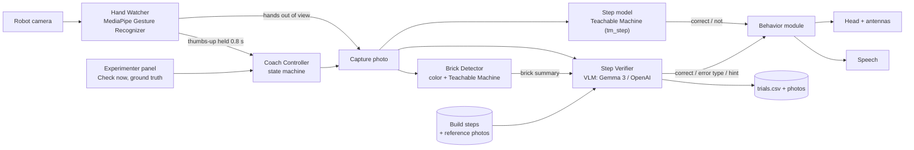

# LEGO Coach for Reachy Mini

A Reachy Mini app that coaches a middle school student through a step-by-step LEGO build.
After each step, the student gives a thumbs-up. The robot waits for their hands to move
out of the way, takes a photo, and checks the step with a vision-language model (VLM).
It then nods and raises its antennas for a correct step, or tilts its head toward the build
and gives a hint for a mistake.

Built on the course starter code ([Cornell-Tech-HRI-Students-2026/lab3](https://github.com/Cornell-Tech-HRI-Students-2026/lab3)):
same Ollama / OpenAI model setup, same head and antenna helpers and safety limits, packaged
as a Reachy Mini app with Google MediaPipe added for perception.

INFO 5356 Lab 3: GenAI for HRI, Cornell Tech, Fall 2026.

## Architecture



The controller is a hybrid: a reactive layer (hand and gesture detection at 10 Hz) decides
*when* to check, and a deliberative layer (the VLM) decides *what* the build state is.

| Module | Input | Output | How |
|---|---|---|---|
| Hand Watcher | camera frames | number of hands, hand boxes, thumbs-up | MediaPipe Gesture Recognizer (`perception.py`) |
| Coach Controller | thumbs-up, panel buttons | phase: instruct → watch → wait for hands to clear → check | state machine (`main.py`) |
| Brick Detector | photo, hand boxes | list of named bricks with position | OpenCV color segmentation finds bricks, a Teachable Machine model names each one (`perception.py`, `tm.py`) |
| Step model (baseline) | photo | correct or not for this step | Teachable Machine whole-image classifier, `tm_step` condition (`verifier.py`) |
| Step Verifier | photo, step instruction, reference photo (condition), brick summary | correct, error type, hint | VLM with a JSON answer format (`verifier.py`) |
| Behavior | verdict | head pose, antennas, speech | `behaviors.py` |
| Trial Log | everything above | one CSV row + photo per check | `trial_log.py` |

## Setup

Use Python 3.12, like the course repo.

```bash
git clone <this repo> && cd lego_coach
python3.12 -m venv .venv
source .venv/bin/activate
pip install -e .
cp .env.example .env        # then set ROBOT_IP, and OPENAI_API_KEY if you use the API
```

Free local model (default), same as the course demos:

```bash
ollama pull gemma3:4b
```

To use OpenAI instead, set `LEGO_COACH_API=1` in `.env`. The robot then also speaks with OpenAI's voice.
On first run, the MediaPipe gesture model (about 8 MB) downloads to `~/.cache/lego_coach`.

## Run

On your laptop, with the robot on the same network:

```bash
python -m lego_coach.main
```

Then open the control panel at **http://localhost:8042**.

To run it as an app from the robot's dashboard instead, install it into the robot's
environment (`pip install -e .` on the robot, or publish it with
`reachy-mini-app-assistant publish`). The dashboard lists it as **Lego Coach** and links
to the same control panel. Check the app first with `reachy-mini-app-assistant check .`

### Set up the scene

1. Put the base plate in front of the robot. The robot looks down 22° (`LOOK_AT_BUILD_PITCH` in `config.py`); adjust until the whole plate is in the camera view in the panel.
2. Check the brick colors under your lighting: `python scripts/check_colors.py --webcam`, or on a saved photo.
3. For the `reference_image` condition, build each step correctly once and press **Save reference photo** on that step. Photos are saved to `lego_coach/builds/tower/stepN.jpg`.

## Running the study

The control panel has everything for a session:

- **Participant**, **Build** and **Condition** (the independent variable: `text` or `reference_image` for H2, and the `tm_step` baseline).
- **Move to the next step after a correct check**: leave on for the demo video. Turn it off for staged trials, so you choose the step with Prev / Next.
- **Ground truth for the next check**: before each staged trial, click what you staged (`correct`, `missing brick`, `wrong color`, `wrong position`, `wrong orientation`). It resets after every check.
- **Check now**: triggers a check without the thumbs-up.

A staged trial goes like this:

1. Choose the step, stage the build (correct or with one mistake), and click its ground-truth label.
2. The participant gives a thumbs-up and moves their hands away.
3. The robot checks and responds. The row appears under **Recent checks**.

Everything is saved in `lego_coach_data/`:

- `trials.csv`: one row per check (columns below)
- `images/<trial_id>.jpg`: the photo the VLM saw, and `_annotated.jpg` with detected bricks

| Column | Meaning |
|---|---|
| `condition`, `model` | IV level and VLM used |
| `ground_truth` | what was staged |
| `predicted_correct`, `predicted_error_type` | the robot's call |
| `response_latency_s` | thumbs-up (or button) → robot starts speaking feedback |
| `hands_clear_wait_s` | part of the response time spent waiting for hands to leave |
| `vlm_latency_s` | time for the VLM request alone |
| `detector_counts_match` | brick-detector-only baseline: do color counts match the step's expected bricks? |
| `trigger` | `thumbs_up` or `button` |
| `parse_ok` | did the VLM answer in valid JSON |

### Same photos, both conditions (paired comparison)

The robot only runs one condition per check. To compare both conditions on exactly the
same photos, re-run the saved photos offline (no robot needed):

```bash
python scripts/evaluate_offline.py --trials lego_coach_data/trials.csv --repeats 3
```

Use `--labels your_photos/labels.csv` (columns `image, build, step, ground_truth`) for photos
taken another way. Set `LEGO_COACH_API=1` or `VLM_MODEL=...` to compare models.

### Results

```bash
python scripts/analyze.py lego_coach_data/trials.csv
python scripts/analyze.py offline_results.csv --group-by repeat --chart results.png
```

This prints a Markdown table per condition: step-verification accuracy, mistake detection
rate, false-alarm rate, detection rate for each mistake type (RQ1), error-type accuracy,
latencies (mean ± SD), and the detector-only baseline. It also saves `summary.csv`.

## Recognizing bricks: MediaPipe + Teachable Machine

MediaPipe handles the **hands and the thumbs-up**. MediaPipe's ready-made object detectors
have no LEGO class, so bricks are recognized in two stages:

1. **Find** bricks by color (OpenCV), ignoring areas covered by a hand.
2. **Name** each brick with a Teachable Machine image model trained on close-ups
   (`red_2x4`, `blue_2x2`, ..., plus `not_brick`, which removes table spots and hands).

A second Teachable Machine model, trained on whole photos of each finished stage
(`step0_empty`, `step1`, `step2`, ...), is the **`tm_step`** baseline condition: it checks a
step without the VLM, so you can compare a small model trained for this build against the
general VLM. It can tell correct from incorrect but not which kind of mistake.

Export both from Teachable Machine with **Tensorflow Lite → Floating point**, unzip them into
`models/`, and point `.env` at the folders:

```
models/
  brick_converted_tflite/   model_unquant.tflite, labels.txt
  step_converted_tflite/    model_unquant.tflite, labels.txt
```

```bash
TM_BRICK_MODEL=models/brick_converted_tflite
TM_STEP_MODEL=models/step_converted_tflite
```

Name brick classes color first (`red_2x4`): the app takes the color from the part before the
first `_`. Name step classes with the step number (`step1`, `step 2` and `step_3` all work;
`step0_empty` is the empty plate). Predictions below `TM_MIN_SCORE` (default 0.6) count as unsure.

The panel header shows the brick pipeline in use (`color + teachable machine`). Check it with
`python scripts/check_colors.py --webcam`.

Optional: a MediaPipe object detector trained with Model Maker on LEGO photos can replace both
brick stages; set `LEGO_DETECTOR_MODEL=/path/to/model.tflite`.

## Adding a build

Copy `lego_coach/builds/tower.json`. Each step has an `instruction` (read out loud and given
to the VLM) and `expected` brick counts by color (used for the detector baseline).

## Files

```
lego_coach/
  main.py          the app: control panel API and the coaching loop
  perception.py    MediaPipe hand/gesture watcher, brick detector
  tm.py            runs the Teachable Machine models
  verifier.py      VLM prompt, conditions, answer parsing
  behaviors.py     head, antenna and speech behaviors
  trial_log.py     CSV logging
  config.py        models, conditions, timings (env vars / .env)
  builds/          build definitions and reference photos
  static/          control panel (HTML/JS/CSS)
scripts/
  evaluate_offline.py   re-run saved photos under each condition
  analyze.py            results tables and chart
  check_colors.py       test the brick detector
```
